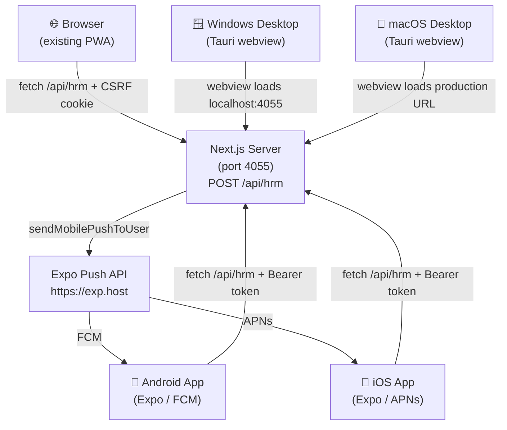

# Finix HR — Multi-Platform Guide

> [!IMPORTANT]
> **Five surfaces:** Browser (existing Next.js PWA) · Android (Expo) · iOS (Expo) · Windows (Tauri) · macOS (Tauri)

---

## 1. Architecture Overview



> [!NOTE]
> **Authentication & Origin Threat Model:**
> - **Missing Origin Header**: Native non-browser clients (React Native Android/iOS, desktop native wrappers) do not emit an `Origin` header. The server accepts missing Origin headers (`!origin`) only after enforcing strict `Content-Type: application/json` and non-ambient `Authorization: Bearer <token>` authentication.
> - **Literal `Origin: "null"` String**: Emitted by browsers in sandboxed iframes, `data:` URIs, or `file://` contexts. The server rejects literal `"null"` origins with HTTP 403 (`Cross-origin request blocked`).
> - **Ambient Cookie CSRF Protection**: When requests present an ambient `hrm_session` cookie (standard web browsers), the CSRF token in `X-CSRF-Token` is strictly mandatory. Attaching an invalid or dummy Bearer header does not bypass this check.

---

## 2. Expo Mobile App (Android + iOS)

### Prerequisites

```powershell
# Only EAS CLI is installed globally; Expo CLI is now built into Expo and run via npx
npm install -g eas-cli
```

> [!CAUTION]
> **Do NOT install `expo-cli` globally (`npm install -g expo-cli`).**  
> The legacy `expo-cli` package is deprecated and archived. All Expo operations must use `npx expo` (which runs the local `@expo/cli` pinned in `mobile/node_modules`). Global legacy CLI installations cause version skew, broken plugin hooks, and deprecation warnings.

### Directory

```
mobile/
├── app.json              # Expo config (bundle IDs, permissions, plugins)
├── eas.json              # EAS Build profiles (development / preview / production)
├── package.json          # Expo 52.0.49, React Native 0.76.9, React 18.3.1
├── tsconfig.json
├── app/
│   ├── _layout.tsx       # Root layout (auth guard, push init)
│   ├── (auth)/
│   │   ├── _layout.tsx
│   │   └── login.tsx     # Email + password + MFA step
│   └── (tabs)/
│       ├── _layout.tsx   # Tab bar (Dashboard · Attendance · Leave · ESS · Profile)
│       ├── index.tsx     # Dashboard stats
│       ├── attendance.tsx# GPS check-in / check-out
│       ├── leave.tsx     # Leave requests
│       ├── ess.tsx       # Payslips + announcements
│       └── profile.tsx   # User info + sign-out
└── src/lib/
    ├── api.ts            # RPC client (Bearer auth, SecureStore token)
    ├── auth.ts           # Zustand auth store (login / MFA / logout)
    ├── push.ts           # Expo push notification registration
    └── location.ts       # Background GPS tracking (expo-location)
```

### Running Locally (Development Builds)

> [!WARNING]
> **Expo Go is NOT supported for Finix HR.**  
> Finix HR uses custom native modules including `expo-task-manager` and background geolocation (`ACCESS_BACKGROUND_LOCATION`), as well as native push notification handlers. These native capabilities are not compiled into the standard Expo Go sandboxed app and will crash at runtime with `TaskManager is not available in Expo Go`.  
> You must run **Expo Development Builds** (`npx expo run:android` or `npx expo run:ios`).

```powershell
# 1. Set API base URL to your dev machine's LAN IP (not localhost — physical devices and emulators cannot resolve localhost)
# Edit mobile/app.json → extra.apiBaseUrl or set EXPO_PUBLIC_API_BASE_URL:
$env:EXPO_PUBLIC_API_BASE_URL = "http://192.168.1.100:4055"

Set-Location mobile
npm install

# 2. Run local native development build on connected Android device/emulator:
npx expo run:android

# 3. Run local native development build on iOS simulator (macOS host only):
npx expo run:ios

# 4. Alternatively, start the Metro bundler for an existing development client:
npx expo start --dev-client
```

### Building for Stores & Testing (EAS Cloud)

EAS Build compiles native binaries in the cloud without requiring local Android Studio or Xcode installations:

```bash
# 1. Authenticate with EAS (first time or in CI with EXPO_TOKEN)
eas login

# 2. Initialize project (links app.json extra.eas.projectId)
eas project:init

# 3. Build Android installable preview APK (for internal QA testing)
eas build --platform android --profile preview

# 4. Build Android production AAB (for Google Play Console)
eas build --platform android --profile production

# 5. Build iOS Ad Hoc IPA (requires registered test device UDIDs)
eas build --platform ios --profile preview

# 6. Build iOS production IPA (for App Store Connect / TestFlight)
eas build --platform ios --profile production

# 7. Submit builds to app stores
eas submit --platform android
eas submit --platform ios
```

### Build Artifact Types vs Store Submission Credentials

To avoid deployment confusion, distinguish the artifact types and the credentials they require:

| Artifact Type | Extension | Distribution Method | Required Build Credentials | Store Submission Credentials |
|---|---|---|---|---|
| **Android Preview APK** | `.apk` | Direct side-load via browser download or `adb install` | Android Keystore (auto-managed by EAS or custom `.jks`) | None (direct installation) |
| **Android Production AAB** | `.aab` | Google Play Console (Play Store generates split APKs) | Production Android Keystore + Google Play App Signing | Google Play Service Account JSON key (for `eas submit`) |
| **iOS Ad Hoc IPA** | `.ipa` | Direct OTA install on registered test devices | Apple Distribution Cert + Ad Hoc Profile (with device UDIDs) | None (direct device installation) |
| **iOS TestFlight / Store IPA**| `.ipa` | App Store Connect (TestFlight beta & public App Store) | Apple Distribution Cert + App Store Provisioning Profile | App Store Connect API Key / Apple ID (for `eas submit`) |

> [!NOTE]
> The **Google Play Service Account JSON key** is used strictly by publishing automation (`eas submit`) to talk to the Google Play Publishing API. It is **never** used to sign the APK/AAB at build time.

### Environment Variables

| Variable | Where set | Purpose |
|---|---|---|
| `EXPO_PUBLIC_API_BASE_URL` | `eas.json` env or shell | Production or staging API server base URL |
| EAS Project ID | `app.json` → `extra.eas.projectId` | Links mobile app builds to your EAS project |

---

## 3. Tauri Desktop App (Windows + macOS)

### Architecture: Online Hybrid Client

Finix HR Desktop uses Tauri v2 to wrap the Finix HR application in a native operating system window powered by Microsoft Edge WebView2 (Windows) and WebKit (macOS).

> [!NOTE]
> **Online Hybrid Client Design:**  
> The desktop client intentionally loads the remote production web application (`https://oms.finixhr.com`) rather than bundling the Next.js Node.js server inside the installer. This provides:
> 1. Ultra-compact installer footprint (NSIS setup is just `1.83 MiB`, MSI is `2.78 MiB`).
> 2. Zero-delay updates: backend bugfixes, HR policy changes, and security updates are immediately available on desktop without forcing users to re-download desktop installers.
> 3. Native OS integration: custom titlebar, OS notification integration, window state persistence, and isolated session storage.

### Local Development vs Production URLs

Tauri separates local development from production build configurations in `desktop/src-tauri/tauri.conf.json`:

```json
"build": {
  "beforeDevCommand": "",
  "devUrl": "http://localhost:4055",
  "beforeBuildCommand": "",
  "frontendDist": "https://oms.finixhr.com"
}
```

- **`devUrl` (`http://localhost:4055`)**: Used during `npm run dev` (`tauri dev`). Tauri launches a window pointing to the locally running Next.js development server.
- **`frontendDist` (`https://oms.finixhr.com`)**: Used during `npm run build` (`tauri build`). The compiled release installer embeds this URL as the default window destination.

### Remote-Origin Capabilities & Security Audit

Loading a remote URL inside a desktop webview presents distinct security considerations. Finix HR enforces strict sandbox isolation:

1. **Zero Ambient Permissions**: The remote frontend has NO access to local files, OS shell commands, or arbitrary process execution. Tauri's native command handler (`desktop/src-tauri/src/lib.rs`) exposes only:
   - `app_version`: Returns the application version string.
   - `tauri-plugin-opener`: Safely delegates external hyperlinks to the operating system's default browser.
2. **CSP & Navigation Guard**: All navigation is restricted to `https://oms.finixhr.com`. External web links cannot hijack the Tauri webview.
3. **Session Cookie Security**: Edge WebView2 manages session cookies in an isolated user data folder (`%LOCALAPPDATA%\com.finixhr.desktop`), protected from cross-browser eavesdropping.

### Quality Assurance Status: Startup Verified

The Windows desktop client has achieved **Startup Verified** status:
- Release binaries compiled: Standalone `finix-hr.exe` (`8.45 MiB`), NSIS setup `Finix HR_1.0.0_x64-setup.exe` (`1.83 MiB`), WiX MSI `Finix HR_1.0.0_x64_en-US.msi` (`2.78 MiB`).
- Windows process launch verified: Starts cleanly (`Responding: True`, PID `10020`), initializes Microsoft Edge WebView2 runtime (`156.0.4314.50`), and spawns GPU/rendering child processes (`msedgewebview2.exe`).
- WiX MSI COM database verified: Valid `ProductCode`, `UpgradeCode`, and component registration.
- *Pending Full QA Pass*: End-to-end automated workflows (employee login, attendance check-in, leave approval, payslip rendering inside the webview) pending live staging server pass.

### Running Locally

```powershell
# 1. Start the Next.js dev server first (port 4055)
Set-Location "c:\Program Files (x86)\MSBuild\OMS"
bun run dev

# 2. In a separate terminal, start Tauri dev (loads http://localhost:4055 in webview)
Set-Location desktop
npm run dev     # runs: tauri dev
```

### Building Installers

```powershell
# Windows (requires Rust 1.99+, MSVC Build Tools 2022, and Windows SDK 10)
Set-Location desktop
npm run build   # produces .msi and .exe in src-tauri/target/release/bundle/
```

For macOS, execute via the authored GitHub Actions workflow (`.github/workflows/desktop-release.yml`) on `macos-latest` (Apple Silicon) and `macos-13` (Intel).

---

## 4. Server-Side Push Notification Pipeline

All five surfaces share the same unified notification system. When `notify()` or `notifyMany()` is called from any server route:

```
notify(vendorId, target, title, message, type, link)
  │
  ├─► db.notification.create()          ← in-app notification (all surfaces via polling)
  ├─► queuePushToUser()                 ← Web Push (browser PWA via VAPID/web-push)
  └─► sendMobilePushToUser()            ← Expo Push API (Android via FCM, iOS via APNs)
```

### Complete Delivery Architecture

1. **Client Registration**:
   - The mobile app requests push permissions on startup (`mobile/src/lib/push.ts`).
   - On physical devices, it retrieves an `ExponentPushToken[xxxxxxxxxxxxxxxxxxxxxx]` from Expo's service.
   - It sends this token to the server via `push.registerDevice` RPC, persisting to the `DeviceToken` table.
2. **Server Dispatch**:
   - Server route `sendMobilePushToUser` in `src/hrm-server/push/mobile-push.ts` queries `db.deviceToken` for the user's active tokens.
   - It batches requests (up to 100 tokens per HTTP request) and dispatches to `https://exp.host/--/api/v2/push/send`.
3. **Expo Routing to Gateways**:
   - Expo servers authenticate with Google Firebase Cloud Messaging (FCM HTTP v1 API) for Android devices.
   - Expo servers authenticate with Apple Push Notification service (APNs) for iOS devices.
4. **Token Lifecycle & Automatic Cleanup**:
   - If a device uninstalls the app or revokes permissions, Expo returns a receipt status with `details.error === "DeviceNotRegistered"`.
   - `mobile-push.ts` automatically executes `db.deviceToken.deleteMany()` for invalid tokens, ensuring zero dead-token bloat.

### Credential Configuration Guide

To enable push notifications in production builds:

#### 1. Android (Firebase Cloud Messaging v1)
1. In [Firebase Console](https://console.firebase.google.com/), create or open your Finix HR project.
2. Go to **Project Settings** → **Service accounts**.
3. Click **Generate new private key** to download the Firebase Service Account JSON key.
4. In your terminal or EAS dashboard:
   ```bash
   eas credentials
   # Select: Android → production → Push Notifications → FCM V1 Service Account Key
   # Upload your downloaded service account JSON
   ```
5. Download `google-services.json` from Firebase and place it in `mobile/google-services.json`, referencing it in `mobile/app.json`:
   ```json
   "android": {
     "googleServicesFile": "./google-services.json"
   }
   ```

#### 2. iOS (Apple Push Notification service - APNs)
1. In your [Apple Developer Account](https://developer.apple.com/account/resources/authkeys/list), go to **Certificates, Identifiers & Profiles** → **Keys**.
2. Click **+** to register a new key, name it "Finix HR Push", and enable **Apple Push Notifications service (APNs)**.
3. Download the `.p8` key file (e.g., `AuthKey_ABCD1234EF.p8`) and note the **Key ID** and your **Team ID**.
4. In your terminal or EAS dashboard:
   ```bash
   eas credentials
   # Select: iOS → production → Push Notifications Key
   # Upload your .p8 file and enter Key ID and Team ID
   ```

### DeviceToken Schema

```prisma
model DeviceToken {
  id        String   @id @default(cuid())
  vendorId  String
  userId    String
  token     String                          // ExponentPushToken[...]
  platform  String   @default("expo")
  createdAt DateTime @default(now())
  updatedAt DateTime @updatedAt

  @@unique([userId, token])
  @@index([vendorId, userId])
  @@index([token])
}
```

---

## 5. Auth Flow for Native Clients

```
POST /api/hrm  { action: "auth.login", payload: { email, password } }
  → { token: "...", user: { id, name, email, role, vendorId } }

All subsequent requests:
  Authorization: Bearer <token>
  X-Requested-With: XMLHttpRequest    ← exempts from CSRF check
  Content-Type: application/json
```

Token is stored in `expo-secure-store` (encrypted native keystore) on mobile.

---

## 6. Production Deployment & Store Submission Checklist

### 6.1 Database Migration & Secrets Setup

- [ ] **Run Pre-Migration Backup**:
  ```bash
  bash scripts/backup.sh
  ```
- [ ] **Apply Database Migrations (Zero Data-Loss)**:
  ```bash
  # In production, ALWAYS use migrate deploy, NEVER migrate dev or db push
  bunx prisma migrate deploy
  ```
- [ ] **Generate Production MFA Secret Key**:
  ```bash
  # Generates 64-character hex key required by instrumentation.ts:
  openssl rand -hex 32
  # Set HRM_MFA_KEY in production .env
  ```
- [ ] **Verify Boot Guard**: Run `bun run start` or inspect system logs to confirm `src/instrumentation.ts` successfully verifies `HRM_MFA_KEY` and passes all boot-time secret checks.

### 6.2 Mobile Release Checklist

- [ ] Update `EXPO_PUBLIC_API_BASE_URL` in `eas.json` production env to `https://oms.finixhr.com`
- [ ] Set real EAS `projectId` in `mobile/app.json`
- [ ] Upload Firebase Service Account JSON (FCM v1) to EAS credentials
- [ ] Upload Apple APNs `.p8` Key to EAS credentials
- [ ] Add branded app icon at `mobile/assets/icon.png` (1024×1024 px)
- [ ] Add branded splash screen at `mobile/assets/splash.png`
- [ ] Add Android monochrome notification icon at `mobile/assets/notification-icon.png`
- [ ] Configure Apple Developer Team ID in `eas.json → submit.production.ios`
- [ ] Execute `eas build --platform android --profile preview` to verify installable APK on test device
- [ ] Verify Google Play API 35/36 compatibility per `docs/SDK-UPGRADE-ROADMAP.md` before submitting production AAB
