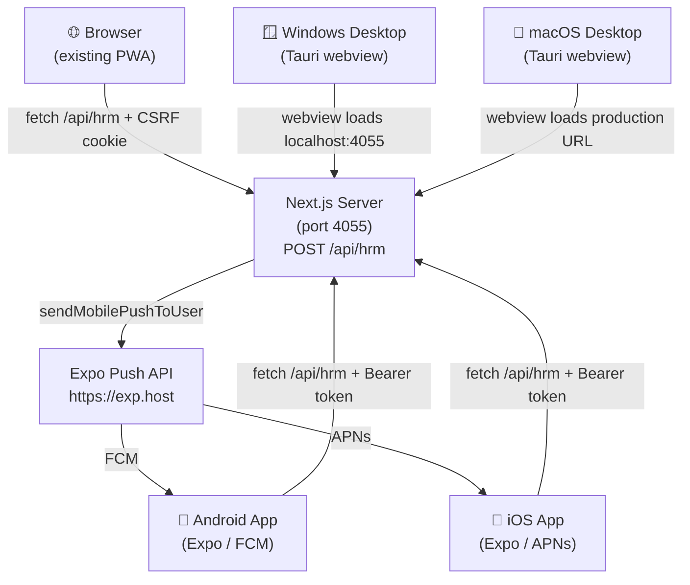

# Finix HR — Multi-Platform Guide

> [!IMPORTANT]
> **Five surfaces:** Browser (existing Next.js PWA) · Android (Expo) · iOS (Expo) · Windows (Tauri) · macOS (Tauri)

---

## 1. Architecture Overview



> [!NOTE]
> Native apps (Android/iOS) send **no `Origin` header** — the server's `isOriginAllowed` returns `true` for null origins (native bypass).
> Bearer auth via `Authorization: Bearer <token>` is already accepted at `/api/hrm`.

---

## 2. Expo Mobile App (Android + iOS)

### Prerequisites

```powershell
npm install -g expo-cli eas-cli
```

### Directory

```
mobile/
├── app.json              # Expo config (bundle IDs, permissions, plugins)
├── eas.json              # EAS Build profiles (development / preview / production)
├── package.json          # Expo ~52, expo-router ~4, expo-notifications
├── tsconfig.json
├── app/
│   ├── _layout.tsx       # Root layout (auth guard, push init)
│   ├── (auth)/
│   │   ├── _layout.tsx
│   │   └── login.tsx     # Email + password + MFA step
│   └── (tabs)/
│       ├── _layout.tsx   # Tab bar (Dashboard · Attendance · Leave · ESS · Profile)
│       ├── index.tsx     # Dashboard stats
│       ├── attendance.tsx# GPS check-in / check-out
│       ├── leave.tsx     # Leave requests
│       ├── ess.tsx       # Payslips + announcements
│       └── profile.tsx   # User info + sign-out
└── src/lib/
    ├── api.ts            # RPC client (Bearer auth, SecureStore token)
    ├── auth.ts           # Zustand auth store (login / MFA / logout)
    ├── push.ts           # Expo push notification registration
    └── location.ts       # Background GPS tracking (expo-location)
```

### Running locally

```powershell
# 1. Set API base URL to your dev machine's LAN IP (not localhost — emulator can't reach it)
# Edit mobile/app.json → extra.apiBaseUrl or set EXPO_PUBLIC_API_BASE_URL

Set-Location mobile
npm install
npx expo start               # scan QR with Expo Go
npx expo start --android     # Android emulator
npx expo start --ios         # iOS simulator (macOS only)
```

### Building for stores (EAS)

```bash
# Login to EAS
eas login

# Create project (first time only)
eas project:init

# Build Android APK (internal test)
eas build --platform android --profile preview

# Build both platforms for production
eas build --platform all --profile production

# Submit to stores
eas submit --platform android
eas submit --platform ios
```

> [!TIP]
> Set `EXPO_PUBLIC_API_BASE_URL` to your production domain in `eas.json` → `build.production.env` before production builds.

### Environment Variables

| Variable | Where set | Purpose |
|---|---|---|
| `EXPO_PUBLIC_API_BASE_URL` | `eas.json` env or shell | API server base URL |
| EAS Project ID | `app.json` → `extra.eas.projectId` | Links builds to EAS project |

---

## 3. Tauri Desktop App (Windows + macOS)

### Prerequisites

```bash
# Rust toolchain
curl --proto '=https' --tlsv1.2 -sSf https://sh.rustup.rs | sh

# Node dependencies
cd desktop
npm install
```

### Directory

```
desktop/
├── package.json              # tauri CLI wrapper
└── src-tauri/
    ├── tauri.conf.json       # App config (name, identifier, window size, devUrl)
    ├── Cargo.toml            # Rust crate
    ├── build.rs
    └── src/
        ├── main.rs           # Entry point
        └── lib.rs            # Tauri commands
```

### Running locally

```powershell
# 1. Start the Next.js dev server first (port 4055)
Set-Location "c:\Program Files (x86)\MSBuild\OMS"
bun run dev

# 2. In a separate terminal, start Tauri dev (loads http://localhost:4055 in webview)
Set-Location desktop
npm run dev     # runs: tauri dev
```

> [!NOTE]
> `tauri.conf.json` sets `"devUrl": "http://localhost:4055"` — the Tauri window simply wraps the running Next.js server. No separate frontend build is needed.

### Building installers

```bash
# Windows: produces .msi and .exe installers in src-tauri/target/release/bundle/
# macOS: produces .dmg and .app in src-tauri/target/release/bundle/

npm run build   # runs: tauri build
```

> [!IMPORTANT]
> For macOS code signing, set `signingIdentity` in `tauri.conf.json → bundle.macOS` and have your Apple Developer certificate in Keychain.
> For Windows, optionally set a code-signing certificate thumbprint.

### Production URL

For a production release (pointing at your hosted server, not localhost):

1. Edit `desktop/src-tauri/tauri.conf.json`:
   ```json
   "build": {
     "frontendDist": "https://your-production-domain.com",
     "devUrl": "http://localhost:4055"
   }
   ```

---

## 4. Server-Side Push Notification Pipeline

All five surfaces share the same notification system. When `notify()` or `notifyMany()` is called from any server route:

```
notify(vendorId, target, title, message, type, link)
  │
  ├─► db.notification.create()          ← in-app notification (all surfaces via polling)
  ├─► queuePushToUser()                 ← Web Push (browser PWA via VAPID/web-push)
  └─► sendMobilePushToUser()            ← Expo Push API (Android via FCM, iOS via APNs)
```

### Device Token Registration (mobile)

When the mobile app launches after login it calls:

```typescript
// mobile/src/lib/push.ts
registerForPushNotifications()
  → Notifications.getExpoPushTokenAsync()
  → rpc("push.registerDevice", { token, platform })  // stores in DeviceToken table
```

### DeviceToken Schema

```prisma
model DeviceToken {
  id        String   @id @default(cuid())
  vendorId  String
  userId    String
  token     String                          // ExponentPushToken[...]
  platform  String   @default("expo")
  createdAt DateTime @default(now())
  updatedAt DateTime @updatedAt

  @@unique([userId, token])
  @@index([vendorId, userId])
  @@index([token])
}
```

---

## 5. Auth Flow for Native Clients

```
POST /api/hrm  { action: "auth.login", payload: { email, password } }
  → { token: "...", user: { id, name, email, role, vendorId } }

All subsequent requests:
  Authorization: Bearer <token>
  X-Requested-With: XMLHttpRequest    ← exempts from CSRF check
  Content-Type: application/json
```

Token is stored in `expo-secure-store` (encrypted native keystore) on mobile.

---

## 6. Checklist Before Store Submission

- [ ] Update `EXPO_PUBLIC_API_BASE_URL` in `eas.json` production env
- [ ] Set real EAS `projectId` in `mobile/app.json`
- [ ] Add real app icon at `mobile/assets/icon.png` (1024×1024 px)
- [ ] Add splash screen at `mobile/assets/splash.png`
- [ ] Add notification icon at `mobile/assets/notification-icon.png`
- [ ] Configure Apple Developer Team ID in `eas.json → submit.production.ios`
- [ ] Run `bun run db:migrate` in production to apply `DeviceToken` migration
- [ ] Test push notifications on a physical device before submission
