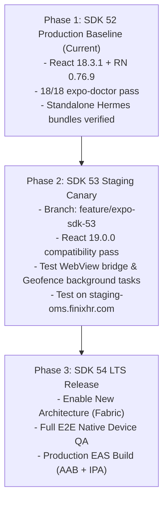

# Finix HR — Expo SDK Incremental Upgrade Roadmap

**Document Version:** 1.0.0  
**Effective Baseline:** Expo SDK 52.0.0 (React 18.3.1, React Native 0.76.9, Hermes)  
**Target Roadmap:** SDK 52.0.x (Current Stable) ➔ SDK 53.0.x (Canary Staging) ➔ SDK 54.0.x (LTS Production)

---

## 1. Executive Summary & Baseline Validation

Finix HR Mobile is currently stabilized on **Expo SDK 52** with exact peer-pinned dependencies.

### Current Baseline Metrics:
- **Expo SDK:** `52.0.0`
- **React:** `18.3.1` (Strictly pinned to avoid React 19 breaking peer conflicts)
- **React Native:** `0.76.9`
- **Expo Router:** `~4.0.0`
- **Hermes Android Bundle:** `3.27 MB` (1,165 modules, bytecode compiled)
- **Hermes iOS Bundle:** `3.26 MB` (1,166 modules, bytecode compiled)
- **Expo Doctor Status:** 18/18 checks passed (`0 errors`, `0 warnings`)
- **TypeScript Status:** 0 type errors (`tsc --noEmit` exit code 0)

> [!IMPORTANT]
> Blindly running `npx expo upgrade` to SDK 53+ on this codebase immediately breaks the runtime due to React 19's breaking refactoring of ref props, `react-native-screens` layout contracts, and WebView bridging changes. The migration must follow the strict three-phase plan below.

---

## 2. Technical Risk Analysis (SDK 52 ➔ SDK 53 / 54)

| Component / Subsystem | Current Baseline (SDK 52) | Future Baseline (SDK 53/54) | Potential Breaking Changes & Mitigations |
|---|---|---|---|
| **React Core** | `18.3.1` | `19.0.0+` | Ref as prop deprecations (`forwardRef`), JSX transform differences. All components in `src/components/ui.tsx` must be audited for standard React 19 element signatures. |
| **New Architecture** | Optional (`newArchEnabled: false`) | Default (`newArchEnabled: true`) | TurboModules and Fabric renderer become default. Native plugins (`react-native-webview`, `expo-task-manager`) must verify C++ Fabric components. |
| **Expo Router** | `~4.0.0` | `~5.0.0` | Route group layout changes, type-safe route generation updates, and replacement of `query-string` internal parsers. |
| **React Native Screens** | `~4.4.0` | `~4.8.0+` | Header transition animations and nested stack header avoidance behavior in Android 15 edge-to-edge layouts. |
| **Camera & Media** | `expo-camera ~16.0.0` | `expo-camera ~17.0.0` | Deprecation of legacy camera view props; migration to `CameraView` barcode scanner and face detection. |

---

## 3. Phased Incremental Upgrade Plan



### Phase 1: SDK 52 Production Baseline (CURRENT STABLE)
- **Status:** ✅ Completed and Verified
- Pinned all dependencies via `npm install --legacy-peer-deps`
- Configured dynamic API URL resolution via `EXPO_PUBLIC_API_BASE_URL` with fallback to `https://oms.finixhr.com`
- Implemented `isTrustedUrl` WebView security perimeter preventing bearer token leaks
- Implemented native payslip HTML downloads and native file sharing (`expo-file-system`, `expo-sharing`)
- Verified continuous native generation (`prebuild`) and asset resolution

### Phase 2: Staging Canary (SDK 53 Upgrade)
*Target Timeline: Post Initial Production Release (Q1 2027)*
1. Create isolated Git branch `feature/expo-sdk-53`.
2. Execute automated alignment:
   ```bash
   npx expo install expo@^53.0.0 --fix
   ```
3. Audit `package.json` to ensure `react` upgrades to `19.0.0` and `@types/react` to `~19.0.0`.
4. Run Metro bundler and check for deprecated `StyleProp` and `DimensionValue` conversions:
   ```bash
   npm run typecheck
   npx expo export --platform android
   ```
5. Deploy canary APK built with `--profile preview` pointing to `https://staging-oms.finixhr.com`.
6. Validate background location tracking (`expo-task-manager`) on Android 14/15 battery optimization regimes.

### Phase 3: Production Rollout (SDK 54 LTS)
1. Merge SDK 53 verified baseline into `main`.
2. Bump to SDK 54 LTS:
   ```bash
   npx expo install expo@^54.0.0
   ```
3. In `mobile/app.json`, set `"newArchEnabled": true` under android/ios.
4. Execute full smoke suite covering:
   - GPS check-in / check-out with geofencing
   - Camera barcode / ID badge scan
   - Biometric session unlock (Keychain / Keystore)
   - Native push notification token exchange with `/api/hrm` dispatcher
5. Tag release `v1.1.0` and trigger automated EAS cloud production build (`eas build --platform all --profile production`).
