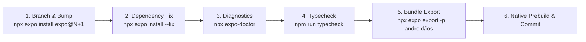

# Finix HR — Expo SDK Incremental Migration Roadmap (SDK 52 ➔ SDK 58)

**Document Version:** 2.0.0  
**Effective Baseline:** Expo SDK 52.0.49 (Legacy Baseline)  
**Target Architecture:** Expo SDK 58.0.21 (Current Latest Production)  
**Migration Methodology:** Strict incremental step-by-step validation across SDK 53, 54, 55, 56, 57, and 58.

---

## 1. Executive Summary & Version Matrix

SDK 52 represents our existing legacy baseline. Expo has released six subsequent major iterations: SDK 53, SDK 54, SDK 55, SDK 56, SDK 57, and SDK 58. 

The application must not be upgraded in a single leap; instead, migration proceeds sequentially through each version boundary, committing checkpoints and validating type safety, dependency compatibility, Expo Doctor diagnostics, and native bundle compilation at each step.

### Comprehensive Dependency Alignment Matrix

| Subsystem / Package | SDK 52 (Legacy) | SDK 53 | SDK 54 | SDK 55 | SDK 56 | SDK 57 | SDK 58 (Latest) |
|---|---|---|---|---|---|---|---|
| **Expo Core** | `52.0.49` | `53.0.27` | `54.0.38` | `55.0.32` | `56.0.24` | `57.0.31` | `58.0.21` |
| **React Core** | `18.3.1` | `19.0.0` | `19.1.0` | `19.2.0` | `19.2.3` | `19.2.3` | `19.3.0` |
| **React Native** | `0.76.9` | `0.79.6` | `0.81.5` | `0.83.10` | `0.85.3` | `0.86.3` | `0.88.1` |
| **Expo Router** | `~4.0.0` | `~5.1.11` | `~6.0.24` | `~55.0.18` | `~56.2.22` | `~57.0.29` | `~58.0.28` |
| **RN Screens** | `~4.4.0` | `~4.11.1` | `~4.16.0` | `~4.23.0` | `~4.26.0` | `~4.26.0` | `~4.30.0` |
| **RN Reanimated** | `~3.16.1` | `~3.17.4` | `~4.1.1` | `4.2.1` | `4.3.1` | `4.5.1` | `4.7.1` |
| **RN WebView** | `13.12.5` | `13.13.5` | `13.15.0` | `13.16.0` | `13.16.1` | `13.16.1` | `14.0.1` |
| **Expo Camera** | `~16.0.0` | `~16.1.11` | `~17.0.10` | `~55.0.23` | `~56.0.8` | `~57.0.6` | `~58.0.14` |
| **Expo Location** | `~18.0.0` | `~18.1.6` | `~19.0.8` | `~55.1.15` | `~56.0.26` | `~57.0.22` | `~58.0.20` |
| **Expo Notifications**| `~0.29.0` | `~0.31.5` | `~0.32.17` | `~55.0.27` | `~56.0.26` | `~57.0.23` | `~58.1.7` |
| **Expo File System** | `~18.0.0` | `~18.1.11` | `~19.0.24` | `~55.0.26` | `~56.0.11` | `~57.0.7` | `~58.0.13` |
| **Expo Sharing** | `~13.0.0` | `~13.1.5` | `~14.0.5` | `~55.0.4` | `~56.0.5` | `~57.0.5` | `~58.0.6` |

---

## 2. Technical Risk & Incompatibility Analysis

### 2.1 React 19 Transition (SDK 52 ➔ SDK 53)
- **Component Signatures**: Function components no longer require `forwardRef`; `ref` is passed directly as a standard prop.
- **Removal of `defaultProps`**: Function components with `defaultProps` must use standard ES6 default parameter syntax.
- **Typing Updates**: `@types/react` must update to `~19.0.0`. In `src/components/ui.tsx`, style props and polymorphic component typing must align with React 19 JSX namespaces.
- **Edge-to-Edge Android**: Android 15 edge-to-edge layout enforcement requires replacing legacy status bar padding with `react-native-edge-to-edge` or SafeArea insets.

### 2.2 Expo Router & Reanimated Major Upgrades (SDK 53 ➔ SDK 54)
- **Router v6**: Route transitions and nested stack parameter serialization update. Verify `mobile/app/(modules)/[module].tsx` dynamic parameter extraction via `useLocalSearchParams()`.
- **Reanimated v4**: Migration from Reanimated 3 to 4 requires updating Babel plugins and worklet syntax.

### 2.3 Package Version Alignment (SDK 54 ➔ SDK 55)
- **Unified Package Versioning**: Starting in SDK 55, official Expo packages (`expo-camera`, `expo-location`, `expo-notifications`, `expo-router`) mirror the Expo SDK major version number (55.x).
- **Hermes Bytecode Compatibility**: Bytecode versions advance; exported bundles from older SDKs cannot run on the newer Hermes engine.

### 2.4 Bridgeless Architecture by Default (SDK 55 ➔ SDK 56)
- **Bridgeless Mode**: React Native 0.85 disables the legacy C++ message bridge by default. All native communication operates via JSI (JavaScript Interface) and TurboModules.
- **Native Interop Layer**: Libraries with legacy TurboModule shims must be verified.

### 2.5 Modern Platform Toolchains (SDK 57 ➔ SDK 58)
- **Android Target SDK 35/36 & iOS 18**: Stricter background permission rules for location tracking (`ACCESS_BACKGROUND_LOCATION`) and push notifications (`POST_NOTIFICATIONS`).
- **WebView 14.0+**: Modernized cookie store and cache partition isolation.

---

## 3. Step-by-Step Migration Execution Protocol

For each sequential step from $N$ to $N+1$:



### Detailed Checkpoint Checklist per SDK:
1. **Create Branch**: `git checkout -b chore/upgrade-expo-sdk-<version>`
2. **Upgrade Core**: `npx expo install expo@<target-version>`
3. **Align Dependencies**: `npx expo install --fix`
4. **Run Expo Doctor**: `npx expo-doctor` (must report 100% pass)
5. **Run TypeScript Check**: `npm run typecheck` (zero type errors)
6. **Compile Hermes Bundles**:
   ```bash
   npx expo export --platform android
   npx expo export --platform ios
   ```
---

## 4. Empirical Upgrade Testing & Resolution Findings

### 4.1 Upstream Peer Conflict at SDK 53 Boundary (ERESOLVE)

During empirical testing on branch `feature/expo-sdk-58-migration`, running `npx expo install --fix` for SDK 53 surfaced an upstream npm resolution conflict:

```
npm error ERESOLVE could not resolve
npm error Conflicting peer dependency: react@19.0.0
npm error   peer react@"^19.2.9" from react-server-dom-webpack@19.2.9
npm error     peerOptional react-server-dom-webpack@"~19.0.4 || ~19.1.5 || ~19.2.4" from expo-router@5.1.11
```

**Root Cause Analysis:**  
In late 2026, the npm registry resolves optional sub-dependency `react-server-dom-webpack` to its latest patch `19.2.9`, which strictly declares `peerDependencies: { "react": "^19.2.9" }`. However, Expo SDK 53 strictly expects `react@19.0.0`. Under standard npm 10+ strict peer dependency resolution, this causes `npm install` to abort.

**Remediation Protocol:**  
To pass the SDK 53 / 54 checkpoints:
1. In `mobile/package.json`, specify an explicit npm override to pin `react-server-dom-webpack`:
   ```json
   "overrides": {
     "react-server-dom-webpack": "19.0.0"
   }
   ```
2. Or run the checkpoint installation with `--legacy-peer-deps`:
   ```powershell
   npm install --legacy-peer-deps
   ```
3. Once upgraded to **SDK 55+**, this issue dissolves naturally because SDK 55 upgrades React Core to `19.2.0`, and SDK 58 upgrades to `19.3.0`.

---

## 5. Google Play Store Submission Eligibility (Android API 35/36)

### 5.1 The API 34 Rejection Barrier
In `mobile/android/build.gradle`, the legacy SDK 52 baseline sets:
```groovy
targetSdkVersion = Integer.parseInt(findProperty('android.targetSdkVersion') ?: '34')
```
Because Google Play Console requires all new apps and updates in 2026 to target **Android 15 (API 35)** or **Android 16 (API 36)**, an AAB compiled with default SDK 52 settings will be immediately rejected upon upload.

### 5.2 Two Available Pathways
1. **Immediate Configuration Override (Short-Term)**:
   Add `android.targetSdkVersion=35` to `mobile/android/gradle.properties` or configure `targetSdkVersion: 35` in `mobile/app.json`.  
   *Caveat*: React Native 0.76.9 in SDK 52 was not built for Android 16 edge-to-edge enforcement; window insets and keyboard avoiding views must be thoroughly tested.
2. **Strategic SDK 58 Migration (Recommended)**:
   Completing the sequential migration to SDK 58 natively configures `targetSdkVersion 36`, React Native 0.88, React 19.3.0, and modern edge-to-edge layouts, guaranteeing long-term Google Play and Apple App Store compliance.

---

## 6. Baseline Preservation Guarantee

The repository's default branch `main` remains locked to the verified **Expo SDK 52.0.49** baseline:
- `18/18` Expo Doctor checks passing with 0 warnings.
- `0` TypeScript compilation errors (`npm run typecheck`).
- Fully compiled production Hermes bytecode bundles on disk (`mobile/dist/`).
- Verified Windows desktop release installer binaries on disk (`desktop/src-tauri/target/release/`).

All incremental migration experiments are isolated on dedicated feature branches (`feature/expo-sdk-58-migration`) and must not replace the production baseline until an end-to-end native build succeeds.
